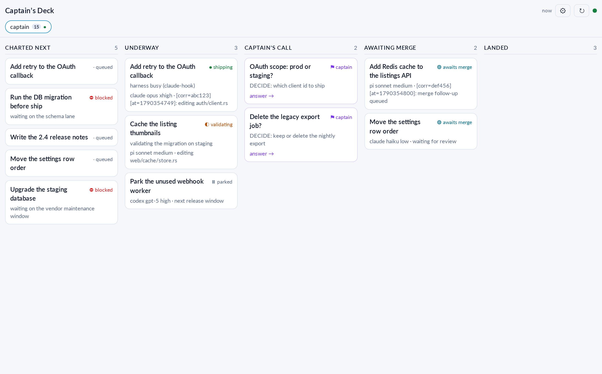
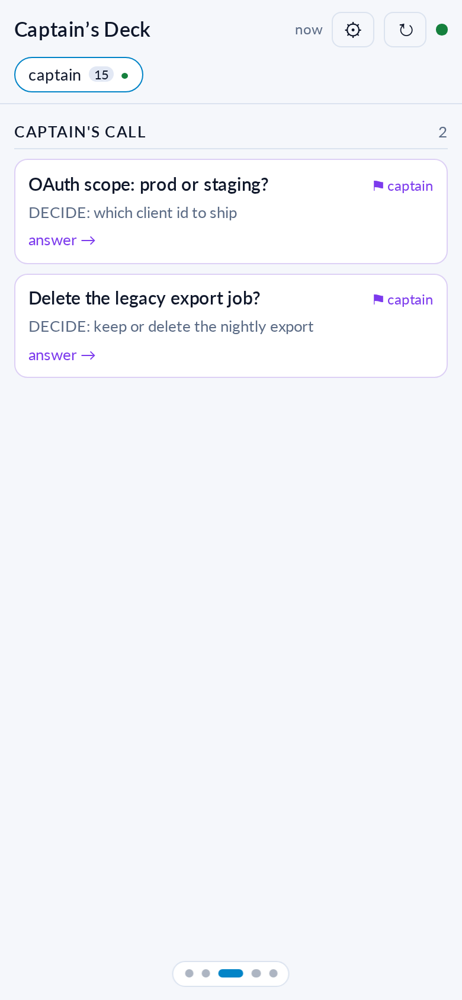

# Captain's Deck web deck

The board on a phone or in a desktop browser, with Captain's Call answers and Web
Push notifications. It serves the same board the TUI shows: the bridge imports
`../scripts/flow_tui.py` instead of reimplementing it, so the two views cannot
drift apart.



On a phone the board pages one column per screen: swipe to the next column, or
tap a dot to jump.



## Requirements

| Requirement | Why |
| --- | --- |
| Python 3.11+ with `aiohttp` and `cryptography` | HTTP, WebSocket and Web Push. No other package is needed |
| Firstmate with the decision-card store (`state/decision-cards/<task>.json`, `schema: fm-decision-card.v1`) | The ticket dialog reads `options`, `hint`, `recommend_value` and `close` from it |
| Firstmate whose `bin/fm-captain-hold.sh` defines `wake_answer_owner` | The intake wakes the owning home itself; without it the deck falls back to its own lane wake |
| A tailnet for the HTTPS origin | A service worker, an installed web app and Web Push all need a secure context |

Without the decision-card store the deck still runs, with the snapshot title and
hold reason and a freeform answer only.

## Run

```bash
cd web
python3 tools/make_icons.py      # once: writes static/icons
python3 bridge.py                # http://127.0.0.1:8787
```

| Variable | Default | Meaning |
| --- | --- | --- |
| `CD_WEB_BIND` | `127.0.0.1` | Bind address. Keep loopback: Tailscale Serve terminates TLS |
| `CD_WEB_PORT` | `8787` | Port |
| `CD_WEB_DATA` | `~/.config/captains-deck-web` | VAPID keys and device subscriptions |
| `CD_WEB_VAPID_SUBJECT` | the tailnet address | VAPID contact. Apple refuses a `mailto:` whose domain it cannot believe; an `https:` URI is accepted |
| `CD_WEB_TICK_SECS` | `1.0` | How often a WebSocket client checks for a new snapshot |
| `FM_FLOW_SCRIPTS` | `../scripts` | The deck model |

## Run it as a user service

`~/.config/systemd/user/captains-deck-web.service`:

```ini
[Unit]
Description=Captain's Deck web bridge
After=default.target

[Service]
Type=simple
WorkingDirectory=/path/to/captains-deck/web
ExecStart=/usr/bin/python3 /path/to/captains-deck/web/bridge.py
Environment=PATH=%h/.local/bin:/usr/local/bin:/usr/bin:/bin
Restart=always
RestartSec=3

[Install]
WantedBy=default.target
```

```bash
systemctl --user daemon-reload
systemctl --user enable --now captains-deck-web.service
loginctl enable-linger "$USER"        # keep it up without a login
journalctl --user -u captains-deck-web -f
```

## Publish it to your tailnet

```bash
sudo tailscale serve --bg --https=443 http://127.0.0.1:8787
```

Tailscale terminates TLS with a real certificate for
`https://<device>.<tailnet>.ts.net`, so the page is a secure context and nothing
is exposed to the public internet. `tailscale serve reset` removes it.

## Notifications

Web Push needs no account, no API key and no third-party service. The browser
returns a subscription: an endpoint plus two keys the bridge encrypts to
(RFC 8291), with a VAPID identity per RFC 8292.

* On iOS and iPadOS, push works **only** for a web app added to the Home Screen
  (16.4 and later). A Safari tab receives nothing.
* The bridge announces a new Captain's Call, and the app shows the open-call
  count as its icon badge.
* Settings -> Notifications turns it on for one device; "Send a test" proves the
  path.

Check the whole path with no Apple or Google account:

```bash
python3 tools/push_selftest.py
```

It stands in for a push service on loopback, subscribes through the running
bridge, and verifies the VAPID signature and the decrypted payload, including
the RFC 8291 Appendix A vector.

## Endpoints

| Method | Path | Purpose |
| --- | --- | --- |
| `GET` | `/api/board` | Board JSON. `?home=<label>` selects a crew |
| `GET` | `/api/ticket/<key>` | Captain's Call dialog content |
| `POST` | `/api/ticket/<key>/answer` | Submit `{"value": "...", "note": "..."}` |
| `GET` | `/api/push/key` | The VAPID public key a browser subscribes with |
| `GET` | `/api/push/status` | How many devices receive notifications |
| `POST` | `/api/push/subscribe` | Store one subscription |
| `POST` | `/api/push/unsubscribe` | Forget one endpoint |
| `POST` | `/api/push/test` | Send one notification to every stored device |
| `GET` | `/ws` | Board updates. Client frames: `home`, `refresh`, `ticket` |
| `GET` | `/*` | The PWA shell |

## Safety

* The answer endpoint accepts only a ticket that is on the current board, only in
  the Captain's Call column, and only an option the dialog offers. The note is
  bounded by `ANSWER_LIMIT`, the intake's own limit.
* The answer is written by `flow_tui.run_submit`, the same path the TUI uses,
  including the owner wake.
* The bridge binds to loopback, so only tailnet members reach it.
* VAPID keys and subscriptions live in `CD_WEB_DATA` with mode 600.
